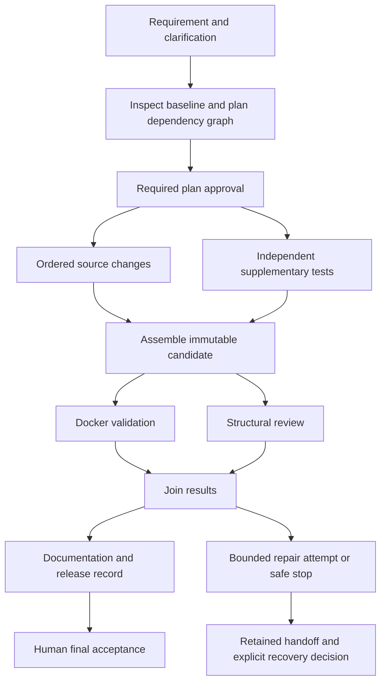

# Architecture and scope

The prototype is one offline Python CLI/harness and one example product: a
FastAPI/SQLite URL shortener. It transforms supported requirements into reviewable
source, tests, API/schema artifacts and release records. There is no online model,
fixed-answer demonstration mode, web UI or hosted deployment.

The requirement language and source transformations are finite rules. The PDF
requires agentic orchestration but does not explicitly prescribe a runtime model.
This implementation demonstrates controlled multi-step execution; it does not
claim unrestricted language understanding or arbitrary code generation. That
boundary remains an assessment risk, even with complete workflow evidence.

## Components and control flow

`cli.py` exposes operator actions. `engine.py` schedules a validated task graph,
with sequential code writers, an independent test task and at most two concurrent
tasks. It also synchronizes validation and review. `models.py` rejects cycles,
unknown task kinds and unordered overlapping writers.

`local_provider.py` parses complete supported English statements and derives work
from the requirement and inspected source. `domain.py` inspects the known source
family with Python AST and applies small explicit transformations using the core
template and authored expiration/alias fragments. It does not import candidate
code or copy a pre-completed reference service. Unknown source shapes stop safely.

`store.py` uses SQLite for runs, nodes, revisions, events, approvals and accepted
selection. `artifacts.py` binds changes to their source hashes and role-specific
paths. `runner.py` supervises Docker validation; the `runner/` directory contains
the trusted test worker. `bundle.py` exports the needed source and decision lineage
for integrity checks and independent replay without the original state database.

## Governance and failure handling

- Existing-baseline changes, including alias requirement revisions, require plan
  approval. Final
  acceptance requires matching passing validation and a nonblocking review.
- A new answer creates a revision, invalidates earlier work/approvals and re-plans.
  Per-run locks, revision checks and expected-current hashes reject stale work or
  selection changes. Resuming never implies approval or resets spent budgets.
- Limits are two attempts per operation, two repair attempts per revision, two
  requirement revisions, 20 local dispatches and 30 active minutes. Abrupt process
  termination can undercount the final invocation's elapsed time.
- Retry/repair controls are tested with explicit doubles. The real local backend
  cannot repair unknown failing code; unsupported repair stops with evidence.
- Eligible budget/attempt exhaustion permits an explicit human handoff and one
  authorized replacement using the current accepted baseline. The failed parent
  stays terminal. The replacement has a separate visible budget and normal gates;
  this is approved recovery, not an automatic alternative reasoning strategy.
- Rollback switches the accepted local code/evidence snapshot. It does not roll
  back a running process or user database. The scenario script separately runs a
  real smoke check after rollback.

## Validation, guardrails and traceability

Candidate edits may touch only approved service or generated-test paths. Traversal,
symlinks, deletion payloads, protected-test changes and stale preimages are rejected.
The runner uses non-root Docker with networking disabled, read-only mounts/root,
resource limits and no credentials or Docker socket inside the container.
Protected and generated tests run in separate processes. Required test IDs, actual
exit status and consistent reports must all pass before acceptance.

The trusted local operator and store are not adversarial tenants. Python tests are
not tamper-proof against deliberately hostile code in their process. These are
prototype guardrails, not compliance certification or a production sandbox.

Requirements, plans, input hashes, rule-source hashes, source snapshots, decisions,
attempts and validation results are retained. Bundle checks detect inconsistency;
they are unsigned and cannot independently authenticate who ran the original work.

Metrics report accepted success rate, retry/rollback frequency and end-to-end,
active and waiting time, with denominators. The recovery-time metric measures
successful same-revision recovery after a validation failure. If no such sample
exists, it is N/A; a linked replacement is not relabeled as automatic repair.
Small scripted samples do not establish production reliability.

## Assignment mapping

| Requirement | Implementation and evidence | Boundary |
| --- | --- | --- |
| Requirement understanding and ambiguity | Complete grammar, questions, normalized constraints and revisions | Finite English vocabulary |
| Decomposition and brownfield reasoning | Source inventory, impacted APIs/schema, ordered schema/API changes | Known URL-shortener source family |
| Stateful non-linear orchestration | Dependency graph, parallel task, joins, persisted gates and re-planning | Small bounded graphs |
| Human oversight | Plan/release decisions, rejection, stop, recovery and rollback | Demonstration decisions are explicitly scripted |
| Bounded failure controls | Attempts, budgets, safe stop, handoff, replacement and rollback | Unknown code repair is unsupported |
| Engineering outputs | Service code, API/schema exports, supplementary/protected tests and release documentation | Local prototype, not a hosted production service |
| Observability and metrics | Events, artifact lineage, portable evidence and calculated metrics | Unsigned records; no production MTTR claim |
| Three scenarios | Core from skeleton, expiration enhancement, alias clarification/revision | Expiration and aliases are chosen examples |

The scenario summary is the final engineering summary: it links each requirement,
plan/rationale, before/after capability, changed source hash and actual test result.
Per-release documentation adds risks, assumptions and limitations. API behavior
and setup are documented separately in API.md and the root README.
